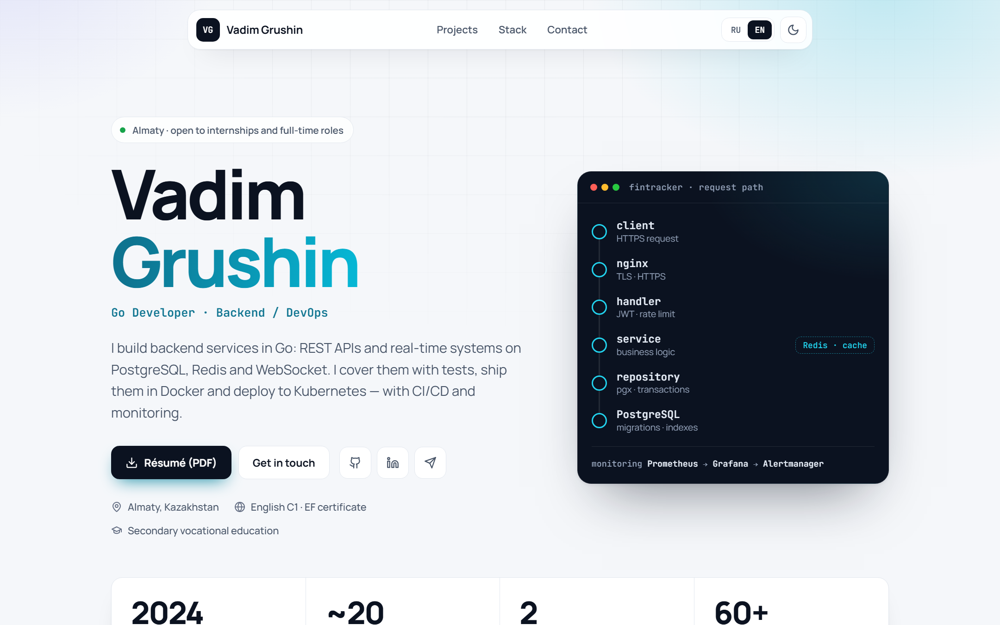
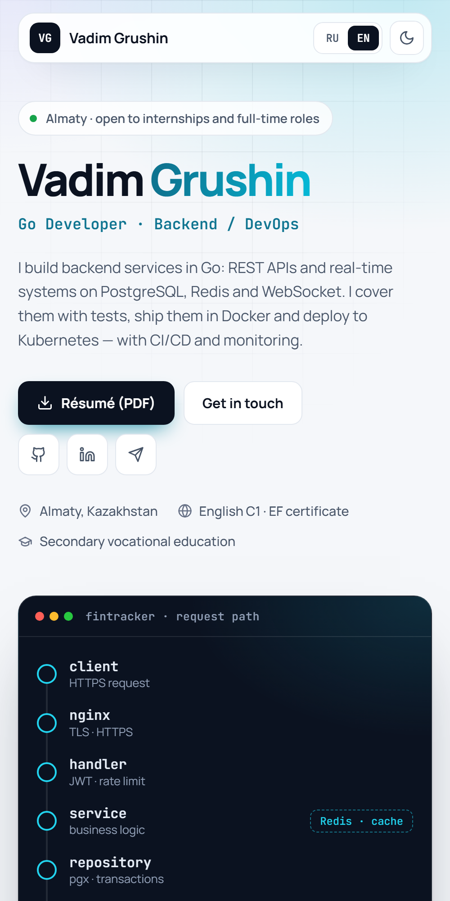
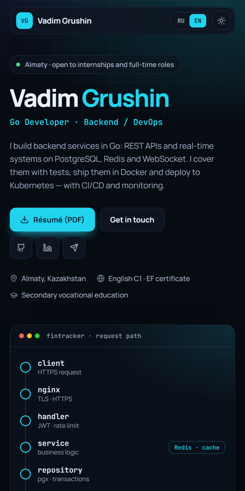
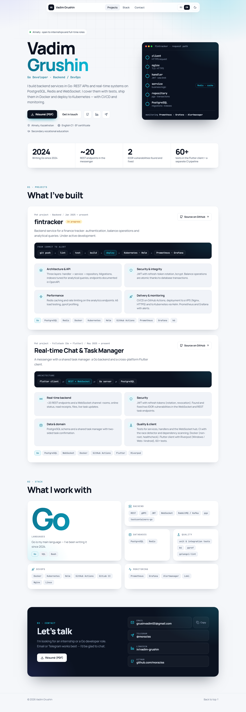
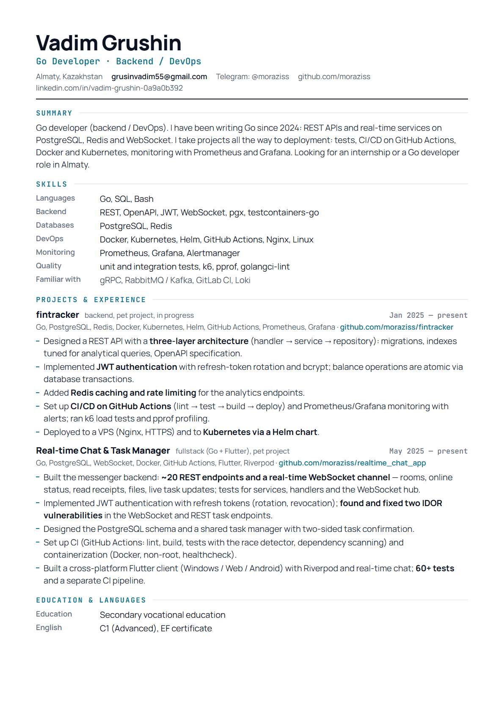

<div align="center">

# Vadim Grushin — Portfolio

**Go developer · Backend / DevOps**<br>
A fast, dependency-free personal site: bilingual (RU / EN), light and dark themes,
rich but accessible motion, and a one-page résumé built from the same source.


**Live: [vadimgrushin.dev](https://vadimgrushin.dev)**

**English** · [Русский](#русская-версия)

<br>

<picture>
  <source media="(prefers-color-scheme: dark)" srcset="docs/screenshots/hero-dark.png">
  
</picture>

</div>

<br>

## What it is

The site I send to recruiters and engineers together with my résumé. It has one job: let someone
understand in ten seconds **what I build, with what, and how well**, then let them dig into the code.

I'm a backend developer, so there is no product UI to screenshot. Instead the page shows how the work is built:

- **The hero is a diagram, not a photo.** An animated trace shows a request travelling through
  [fintracker](https://github.com/moraziss/fintracker): `client → nginx → handler → service → repository → PostgreSQL`, with Redis on the side.
- **Projects are written as case studies**, not bullet lists: an architecture or delivery diagram,
  then four themes (architecture, security, performance, delivery) with the concrete decisions behind them.
- **Facts over adjectives.** A strip of numbers (Go since 2024, ~20 endpoints, 2 IDOR vulnerabilities found and fixed, 60+ tests) instead of "passionate developer".

## Features

| | |
|---|---|
| **Bilingual** | Russian copy lives in the HTML (works without JS, readable by crawlers); the English dictionary is in `main.js`. Deep links: `?lang=en`, `?lang=ru`. |
| **Light / dark** | Light by default, remembered per visitor, `?theme=dark` for sharing. Colors are design tokens in `style.css`. |
| **Motion** | Staggered intro, scroll progress bar, parallax, count-up numbers, diagrams that "run" when scrolled into view, a sliding nav indicator with scroll-spy, magnetic buttons, a 3D-tilt hero card, eased anchor scrolling. The theme switch grows out of the toggle as a circle and the language switch is a blur cross-fade (View Transitions API). |
| **Gentle mode** | Visitors whose OS asks for reduced motion get fades and glows only: slides, zoom, blur, parallax, tilt, loops and the big transitions are dropped (theme and language switches become a plain cross-fade). Add `?motion=full` to preview the full version regardless of the OS setting. |
| **SEO & sharing** | Canonical URL, Open Graph and Twitter cards with a branded preview image (`assets/og-image.png`), schema.org `Person` (JSON-LD), `sitemap.xml`, `robots.txt` and a branded 404 page. |
| **Responsive** | Phone-first layout, no horizontal scroll, tested from 375 px up. |
| **Accessible** | Semantic landmarks, skip link, visible focus, `aria-pressed` toggles, content visible without JS. |
| **Zero dependencies** | Plain HTML, CSS and JavaScript. Only Google Fonts (Manrope, JetBrains Mono) are loaded from outside. |
| **Résumé pipeline** | HTML → PDF with headless Edge/Chrome: single column, real text, correct reading order for ATS. RU and EN. |

## Screenshots

<p align="center">
  
  &nbsp;&nbsp;
  
</p>

<details>
<summary><b>Full page</b></summary>
<br>
<p align="center"></p>
</details>

<details>
<summary><b>Résumé (English, one page)</b></summary>
<br>
<p align="center"></p>
</details>

## Project structure

```
.
├── index.html           markup and the Russian copy (+ Open Graph, JSON-LD)
├── 404.html             not-found page served by GitHub Pages
├── style.css            design tokens, light/dark themes, layout, motion
├── main.js              EN dictionary, language & theme switching, scroll-spy, animations, copy button
├── robots.txt           crawler rules
├── sitemap.xml          sitemap (single canonical URL)
├── assets/              favicon, social preview (og-image.png) and the public résumé PDFs (RU / EN)
├── resume/              résumé sources (HTML + CSS) and the PDF build script
├── scripts/             screenshots.ps1 (README images), og-image.py (social preview)
└── docs/screenshots/    images used in this README
```

## Run locally

No install, no build. Serve the folder with any static server:

```bash
git clone https://github.com/moraziss/portfolio.git
cd portfolio
python -m http.server 5173
```

Open <http://localhost:5173>. Useful parameters: `?lang=en`, `?theme=dark`, `?motion=full`.

## Edit the content

- **Russian text** — directly in `index.html`.
- **English text** — the `EN` object at the top of `main.js`; each key matches a `data-i18n` attribute.
- **Colors and fonts** — CSS variables at the top of `style.css`.

## Rebuild the résumé

```bash
powershell -ExecutionPolicy Bypass -File resume/build.ps1
```

Needs Edge or Chrome. Output:

- `assets/*.pdf` — public versions (no phone number), served by the site; the button follows the page language.
- `resume/dist/*.pdf` — full versions for recruiters. The phone number is read from `resume/phone.local.txt`,
  which is git-ignored, so it never reaches this public repository.

Regenerate the README images with `powershell -ExecutionPolicy Bypass -File scripts/screenshots.ps1`.

## Deploy

GitHub Pages, straight from the `main` branch:

1. **Settings → Pages → Build and deployment →** *Deploy from a branch* → `main` / `(root)`.
2. For a custom domain, enter it under **Custom domain** (GitHub commits a `CNAME` file), then enable **Enforce HTTPS**.
3. DNS at the registrar — apex domain: four `A` records `185.199.108.153`, `185.199.109.153`, `185.199.110.153`, `185.199.111.153`;
   `www`: a `CNAME` to `moraziss.github.io`.

## Contact

[grusinvadim55@gmail.com](mailto:grusinvadim55@gmail.com) ·
[Telegram @moraziss](https://t.me/moraziss) ·
[LinkedIn](https://www.linkedin.com/in/vadim-grushin-0a9a0b392) ·
[GitHub @moraziss](https://github.com/moraziss)

<br>

---

<br>

## Русская версия

<div align="right"><a href="#vadim-grushin--portfolio">↑ English</a></div>

**Вадим Грушин — Go-разработчик · Backend / DevOps.** Быстрый личный сайт без зависимостей: два языка (RU / EN),
светлая и тёмная темы, богатая, но доступная анимация и одностраничное резюме, собранное из тех же исходников.

**Сайт: [vadimgrushin.dev](https://vadimgrushin.dev)**

### Что это

Сайт, который я отправляю рекрутёрам и инженерам вместе с резюме. У него одна задача: за десять секунд
показать, **что я делаю, на чём и насколько хорошо**, а потом дать заглянуть в код.

Я backend-разработчик, поэтому снимать на скриншот нечего: у сервисов нет интерфейса. Вместо этого страница показывает, как устроена работа:

- **Первый экран — схема, а не фото.** Анимированная трассировка показывает путь запроса через
  [fintracker](https://github.com/moraziss/fintracker): `client → nginx → handler → service → repository → PostgreSQL`, сбоку Redis.
- **Проекты оформлены как кейсы,** а не как списки: схема архитектуры или доставки, затем четыре темы
  (архитектура, безопасность, производительность, доставка) с конкретными решениями.
- **Факты вместо эпитетов.** Полоса цифр (Go с 2024 года, ~20 эндпоинтов, 2 найденные и закрытые IDOR-уязвимости, 60+ тестов) вместо «увлечённый разработчик».

Скриншоты (телефон, страница целиком, резюме) — в разделе **Screenshots** выше.

### Возможности

| | |
|---|---|
| **Два языка** | Русский текст лежит в HTML (работает без JS, виден поисковикам), английский словарь — в `main.js`. Прямые ссылки: `?lang=en`, `?lang=ru`. |
| **Светлая / тёмная тема** | По умолчанию светлая, выбор запоминается, `?theme=dark` для ссылки. Цвета — дизайн-токены в `style.css`. |
| **Анимация** | Поэтапное появление, полоса прогресса прокрутки, параллакс, счётчики, схемы, которые «запускаются» при прокрутке, меню со скользящим индикатором и подсветкой раздела, магнитные кнопки, 3D-наклон карточки в первом экране, плавная прокрутка к якорям. Смена темы расходится кругом от переключателя, смена языка — размытое перетекание (View Transitions API). |
| **Мягкий режим** | Если ОС посетителя просит уменьшить движение, остаются только плавные появления и подсветка: сдвиги, масштаб, размытие, параллакс, наклон, зацикленные эффекты и большие переходы отключаются (смена темы и языка становится обычным перетеканием). Параметр `?motion=full` показывает полную версию независимо от настройки ОС. |
| **SEO и превью ссылок** | Канонический адрес, карточки Open Graph и Twitter с фирменной картинкой (`assets/og-image.png`), разметка schema.org `Person` (JSON-LD), `sitemap.xml`, `robots.txt` и своя страница 404. |
| **Адаптивность** | Вёрстка от телефона, без горизонтальной прокрутки, проверена от 375 px. |
| **Доступность** | Семантические блоки, skip-ссылка, видимый фокус, `aria-pressed`, содержимое видно без JS. |
| **Без зависимостей** | Чистые HTML, CSS и JavaScript. Снаружи подгружаются только шрифты Google Fonts (Manrope, JetBrains Mono). |
| **Резюме из исходников** | HTML → PDF через headless Edge/Chrome: одна колонка, настоящий текст, правильный порядок чтения для ATS. RU и EN. |

### Структура проекта

```
.
├── index.html           разметка и русский текст (+ Open Graph, JSON-LD)
├── 404.html             страница «не найдено» для GitHub Pages
├── style.css            дизайн-токены, светлая/тёмная темы, вёрстка, анимации
├── main.js              английский словарь, переключение языка и темы, подсветка меню, анимации, копирование почты
├── robots.txt           правила для поисковых роботов
├── sitemap.xml          карта сайта (один канонический адрес)
├── assets/              фавикон, превью для соцсетей (og-image.png) и публичные PDF резюме (RU / EN)
├── resume/              исходники резюме (HTML + CSS) и скрипт сборки PDF
├── scripts/             screenshots.ps1 (картинки для README), og-image.py (превью для соцсетей)
└── docs/screenshots/    картинки для README
```

### Запуск локально

Установка и сборка не нужны. Достаточно любого статического сервера:

```bash
git clone https://github.com/moraziss/portfolio.git
cd portfolio
python -m http.server 5173
```

Откройте <http://localhost:5173>. Полезные параметры: `?lang=en`, `?theme=dark`, `?motion=full`.

### Как менять содержимое

- **Русский текст** — прямо в `index.html`.
- **Английский текст** — объект `EN` в начале `main.js`; ключ совпадает с атрибутом `data-i18n` у элемента.
- **Цвета и шрифты** — CSS-переменные в начале `style.css`.

### Как пересобрать резюме

```bash
powershell -ExecutionPolicy Bypass -File resume/build.ps1
```

Нужен Edge или Chrome. Результат:

- `assets/*.pdf` — публичные версии (без телефона), их отдаёт сайт; кнопка выбирает PDF по языку страницы.
- `resume/dist/*.pdf` — полные версии для рекрутёров. Телефон берётся из `resume/phone.local.txt`;
  этот файл в `.gitignore`, поэтому в публичный репозиторий он не попадает.

Картинки для README пересоздаются командой `powershell -ExecutionPolicy Bypass -File scripts/screenshots.ps1`.

### Публикация

GitHub Pages прямо из ветки `main`:

1. **Settings → Pages → Build and deployment →** *Deploy from a branch* → `main` / `(root)`.
2. Для своего домена впишите его в **Custom domain** (GitHub сам закоммитит файл `CNAME`) и включите **Enforce HTTPS**.
3. DNS у регистратора — для корневого домена четыре `A`-записи `185.199.108.153`, `185.199.109.153`, `185.199.110.153`, `185.199.111.153`;
   для `www` — `CNAME` на `moraziss.github.io`.

### Контакты

[grusinvadim55@gmail.com](mailto:grusinvadim55@gmail.com) ·
[Telegram @moraziss](https://t.me/moraziss) ·
[LinkedIn](https://www.linkedin.com/in/vadim-grushin-0a9a0b392) ·
[GitHub @moraziss](https://github.com/moraziss)
